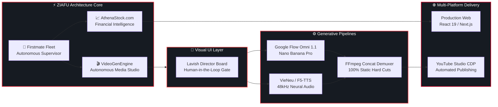

 

  
  
  
  
  

---

## ⚡ Core Architecture & Engineering Pillars

> *"Engineering deterministic, verifiable software runtimes around probabilistic AI models."*

<table>
<tr>
<td width="50%" valign="top">

### 🤖 Autonomous Agent Swarms
- **Single-Contact Supervisor:** Coordinating multi-runtime worker crews (`Firstmate Fleet`) across isolated git worktrees.
- **Strict Verification Gates:** Fail-closed test assertions, linting, and automated review before any code reaches production.
- **Zero Hallucination:** Eliminating model drift through structured brief enforcement and task-bound lifecycle control.

</td>
<td width="50%" valign="top">

### 🎬 Zero-Cost Generative Pipelines
- **Headless Browser Engines:** Automating Google Flow (Omni 1.1 / Nano Banana Pro) via Chrome CDP with **0 recurring API cost**.
- **Neural Speech Synthesis:** 48kHz offline voice production using VieNeu-TTS and zero-shot voice cloning with F5-TTS.
- **Static Demuxer Assembly:** Sub-second video rendering via FFmpeg concat demuxers with 100% static cuts.

</td>
</tr>
<tr>
<td width="50%" valign="top">

### 🎨 Visual UI Layer (Human-in-the-Loop)
- **Lavish Director's Board:** Interactive two-way visual gate between script generation and batch rendering.
- **Single-Shot Iteration:** Real-time feedback loop allowing single-frame re-renders without re-running entire episodes.
- **Contextual Pacing Matrix:** Dynamic pacing balancing 1.0s retention hooks with 3.0s technical infographics.

</td>
<td width="50%" valign="top">

### 🛡️ Zero-Leak Intellectual Property Guard
- **Pre-Commit Security:** Automated Git hooks blocking Channel IDs, internal credentials, and proprietary code before commit.
- **Engine Security Preflight:** Mandatory zero-leak doctor preflights (`./videogen doctor`) in local pipelines.
- **Strict IP Isolation:** Proprietary financial models (AthenaStock) and internal video series kept 100% private.

</td>
</tr>
</table>

---

## 🧠 Ecosystem Flow Architecture

---

## 🚀 Featured Deployments & Systems

| System | Classification | Architecture & Key Capabilities | Runtime | Link |
|---|---|---|---|---|
| 🎬 **VideoGenEngine** |  | Autonomous generative video production engine. Produces documentary shorts & minimalist explainers with **0 API cost**, Lavish Director's Board (Visual UI Layer), multi-tier contextual pacing, Chrome CDP bridge, and anti-voice doubling. | `Node.js · CLI · Daemon` | [**Explore Code ↗**](https://github.com/ziafu000/VideoGenEngine) |
| 📈 **AthenaStock.com** |  | Mindful Investing & Stock Market Valuation platform. Built for long-term compound growth, high-conviction DCF analysis, real-time financial telemetry, and noise-free portfolio management. | `Next.js · React 19 · Cloud` | [**Visit athenastock.com ↗**](https://athenastock.com) |
| 🤖 **Firstmate Fleet** |  | Autonomous multi-agent software engineering supervisor. Coordinates isolated worker crews across multi-repo environments with zero hallucination gates and fail-closed security. | `Agent Harness` | [**Explore Fleet ↗**](https://github.com/ziafu000/firstmate) |
| 🏎️ **Jetracer AI** |  | Autonomous racing car control powered by deep convolutional neural networks, TensorRT acceleration, and computer vision navigation on embedded Linux. | `Python · PyTorch · Linux` | [**Explore Repo ↗**](https://github.com/ziafu000/Jetracer) |

---

## 🛠️ Technical Arsenal

  

---

## 📊 System Telemetry & Commit Rhythm

  

  

### 🐍 Daily Contribution Snake Rhythm

---

## 🌐 Establish Transmission

  

  

